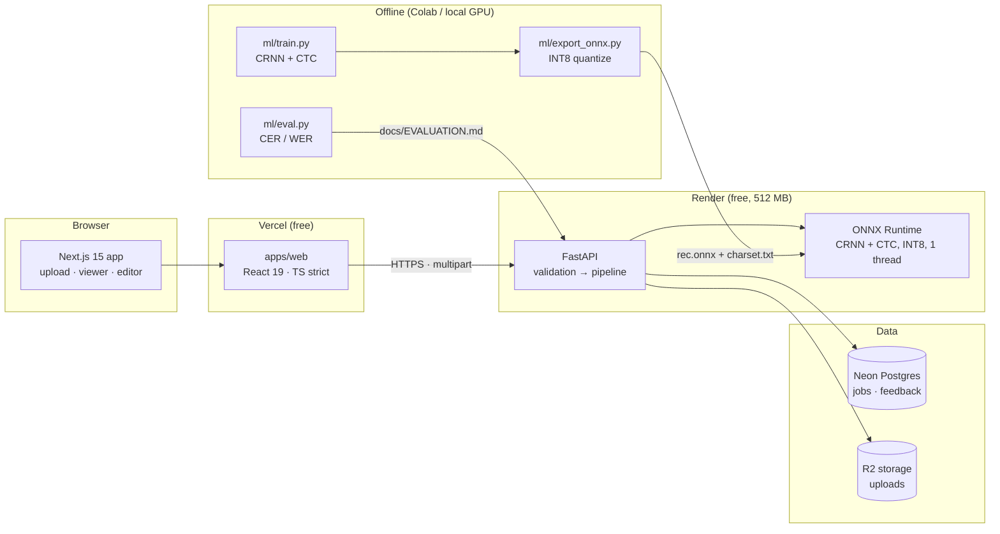

# Varnam OCR

**Production-grade optical character recognition for the Devanagari script** — printed and handwritten Hindi, Marathi, Nepali and Sanskrit — with a typed API, a real web app, measured accuracy, and a deployment that fits entirely on free infrastructure.

> One line: *upload a photo of a Devanagari page, get editable text back with per-line confidence and pixel-accurate bounding boxes.*

---

## Why this project exists

Most Indic OCR demos are a notebook that calls `pytesseract` on a clean scan and reports a number nobody can reproduce. This is the opposite: a deployed system with a documented accuracy harness, honest limits, and code written to be read.

Three decisions define it:

1. **Train/serve parity.** Normalization lives in one shared module used by both the training pipeline and the API, so the two can never drift apart.
2. **Devanagari is not Latin.** Matras, the virama, nukta, anusvara and the danda are combining marks — stripping them during "cleanup" silently corrupts text. The normalization layer is built so that cannot happen.
3. **The free tier is a hard constraint, not an excuse.** A model cannot run in a Vercel function, so inference lives on Render with an INT8 ONNX model, single-threaded, under 150MB RSS.

---

## Architecture



**Why the split:** Vercel serverless functions cap at ~250MB unzipped and ~10s execution. A Devanagari recognizer plus onnxruntime does not fit, and even if it did, a 10s ceiling is below a realistic page latency. Putting the model on Render and the UI on Vercel is the only architecture that is actually free *and* functional. This is the single most useful thing to explain in an interview.

### Request path

```
upload
  → magic-byte validation (never trust the filename or Content-Type)
  → EXIF strip + orientation fix + downscale to 2000px long edge
  → Otsu binarization
  → horizontal projection profile → line boxes
  → reading-order clustering → optional column split
  → per-line CRNN + CTC decode → text + confidence
  → inverse-scale boxes back to original upload coordinates
  → persist job JSON → return typed response
```

---

## Tech stack

| Layer | Choice | Why |
| --- | --- | --- |
| Web | Next.js 15 (App Router), React 19, TypeScript strict | Server components for the landing page, client only where file APIs are needed |
| Styling | Tailwind CSS v4 | CSS-first tokens; no `tailwind.config.js` to drift |
| Validation | Zod at every network boundary | Prevents `undefined` leaking into components after a schema change |
| API | FastAPI, Pydantic v2 | Typed async framework, generated OpenAPI doubles as the client contract |
| Inference | ONNX Runtime, CRNN + CTC, INT8 | ~4MB INT8 model (~4.2M params), CPU-only, no PyTorch in the serving image |
| Persistence | SQLModel + Postgres (SQLite locally) | One class defines table and response shape |
| Storage | Local disk (dev), Cloudflare R2 (prod) | R2 has zero egress cost |
| Testing | pytest + Vitest | Model-free tests; the whole API suite runs in ~1s |
| CI | GitHub Actions | lint → types → tests → build → image build |

---

## Quickstart

Requirements: **Node 20+**, **Python 3.11+**, **pnpm**. Docker is optional.

```bash
git clone https://github.com/<you>/varnam-ocr.git
cd varnam-ocr

# 1. Install
pnpm install
cd services/api && pip install -r requirements-dev.txt && cd ../..

# 2. Configure
cp .env.example .env
cp apps/web/.env.example apps/web/.env.local

# 3. Run (two terminals)
make dev-api     # http://127.0.0.1:8000
make dev-web     # http://127.0.0.1:3000
```

**Windows / PowerShell** (no `make`):

```powershell
# API
$env:PYTHONPATH="$PWD;$PWD\packages"
cd services/api; uvicorn app.main:app --reload --port 8000

# Web (second terminal)
pnpm --filter @varnam/web dev
```

Open <http://localhost:3000/app> and drop a Devenagari page in.

> **No model yet?** That is fine. `VARNAM_ENGINE=auto` falls back to a deterministic stub engine that returns real Hindi sentences, so the entire app — upload, boxes, editor, exports, feedback — is demoable before you train anything. The API reports `"engine": "fake"` so nothing is hidden.

---

## Accuracy

Accuracy numbers live in [`docs/EVALUATION.md`](docs/EVALUATION.md) and are **generated by a command**, never typed by hand:

```bash
python -m ml.eval --manifest data/eval_manifest.csv --engine onnx
```

Acceptance targets for this project:

| Slice | Target CER | Target WER |
| --- | --- | --- |
| Clean printed | ≤ 6% | ≤ 12% |
| Scanned print | ≤ 10% | ≤ 18% |
| Handwritten | ≤ 15% | ≤ 28% |
| Phone photo | ≤ 12% | ≤ 22% |

If a slice has no data yet, the report says *not measured* rather than printing a plausible-looking number. A fabricated benchmark is worse than a missing one — it is the first thing a good interviewer catches.

---

## Training your own model

```bash
pip install -r ml/requirements-train.txt

# 1. Build a manifest from image/text pairs (see data/README.md)
python -m ml.data.prepare --images data/raw --manifest data/train_manifest.csv

# 2. Train on a GPU (Colab T4 is enough)
python -m ml.train --manifest data/train_manifest.csv --charset data/charset.txt --epochs 60

# 3. Export to INT8 ONNX, with a quantization parity check
python -m ml.export_onnx --checkpoint artifacts/best.pt \
    --charset data/charset.txt --out services/api/models

# 4. Verify the artifacts before deploying
python -m ml.verify
```

The export step **fails the build** if INT8 quantization changes more than 5% of predictions — that is the guard against shipping a silently broken model.

---

## API

| Method | Path | Purpose |
| --- | --- | --- |
| `POST` | `/v1/ocr` | Synchronous single-image recognition |
| `POST` | `/v1/ocr/pdf` | Queue a multi-page PDF (202 + job id) |
| `GET` | `/v1/jobs/{id}` | Poll an async job |
| `POST` | `/v1/feedback` | Submit a correction → training sample |
| `GET` | `/health/live` | Liveness (never touches the model) |
| `GET` | `/health/ready` | Readiness (503 until the model loads) |
| `GET` | `/metrics` | Prometheus counters + latency histogram |

```bash
curl -s http://127.0.0.1:8000/v1/ocr -F "file=@page.png" | jq '.text'
curl -s "http://127.0.0.1:8000/v1/ocr?export=hocr" -F "file=@page.png" > page.hocr
```

Full reference: `http://127.0.0.1:8000/docs` (auto-generated OpenAPI).

---

## Project layout

```
varnam-ocr/
├── apps/web/                 Next.js 15 app (deployed to Vercel)
│   ├── app/                  routes: /, /app, /docs
│   ├── components/           dropzone, viewer, editor, export menu
│   └── lib/                  typed API client, Zod schemas, exporters
├── services/api/             FastAPI service (deployed to Render)
│   ├── app/routes/           HTTP layer only
│   ├── app/services/         pipeline, engine, segmentation, storage
│   ├── app/core/             config, errors, logging, metrics, rate limit
│   └── tests/                model-free unit + contract tests
├── packages/devanagari_text/ Shared normalization (train + serve)
├── ml/                       Training, evaluation, ONNX export
├── scripts/                  smoke test, deploy check
├── docs/                     architecture, deployment, evaluation, interview notes
└── data/                     manifest templates + dataset instructions
```

Layering rule, enforced by review: `routes → services → core`. Nothing in `services` imports from `routes`, which is why the pipeline is testable without HTTP.

---

## Testing

```bash
make test        # pytest (75% coverage gate) + vitest
make lint        # ruff + eslint
make typecheck   # mypy strict-ish + tsc --noEmit
make ci          # everything CI runs
```

The test suite deliberately needs **no model, no GPU, no network**:
- `test_normalize.py` pins every combining-mark case (`क्ष`, `ज्ञ`, `र्क`, `कँ`, `क़`) so nobody can "optimize" them away.
- `test_segmentation.py` builds synthetic masks with NumPy.
- `test_api.py` drives the real HTTP stack against `FakeOcrEngine`.
- `test_export.py` checks hOCR is well-formed and that user text is escaped.

---

## Deployment (free tier)

Full walkthrough: [`docs/DEPLOYMENT.md`](docs/DEPLOYMENT.md). The short version:

```
1. Neon    → create a Postgres database, copy the pooled connection string
2. Render  → New Blueprint → render.yaml → paste env vars
3. Vercel  → import repo, root directory = apps/web, set NEXT_PUBLIC_API_BASE_URL
4. Point CORS_ORIGINS on Render at the Vercel URL, redeploy
5. bash scripts/smoke_test.sh https://your-api.onrender.com
```

### Free-tier limits, stated plainly

| Limit | Consequence | Mitigation in this repo |
| --- | --- | --- |
| Vercel: 250MB, 10s functions | Cannot host the model | Model lives on Render; Vercel is UI only |
| Render: 512MB RAM | OOM risk | INT8 model, 1 ORT thread, no memory arena, 10MB upload cap |
| Render: sleeps after 15 min | ~30s cold start | `/health/ready`, client retry with backoff, honest "waking" UI |
| Render: ephemeral disk | Uploads vanish | R2 in production; local disk only in dev |
| Render: single instance | In-process rate limiter | Exact for this topology; Redis path documented |

---

## Honest limitations

Listed in full in [`docs/LIMITATIONS.md`](docs/LIMITATIONS.md). The short list:

- Layout detection is a **heuristic**, not a learned model. Complex multi-column layouts can be mis-ordered.
- Handwriting accuracy is materially worse than print — isolated-character training data does not teach connected writing.
- No Alembic migrations yet; `create_all` is used for the demo deployment.
- Rate limiting is per-instance and resets on restart.
- Word-level text is split proportionally by box width, not by a separate word recognizer.

Each of these has a named next step rather than a vague "future work".

---

## License

MIT — see [LICENSE](LICENSE). Datasets used for training keep their own licenses; record them before distributing weights.

---

**Built to be read.** Every module explains *why* it exists, every non-obvious constant has a comment justifying its value, and every free-tier compromise is annotated at the exact line it happens.
