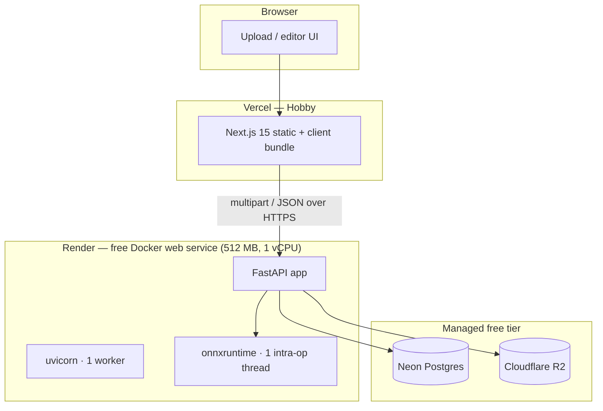
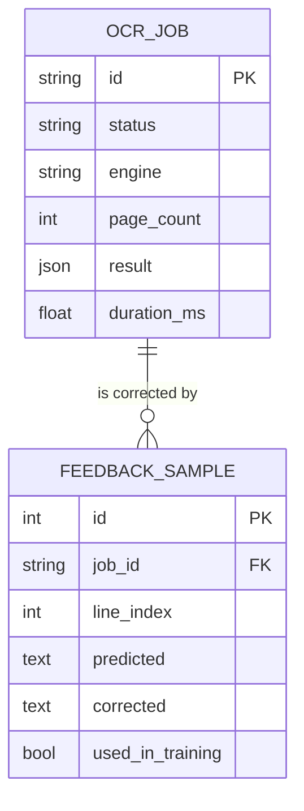

# Architecture

## 1. Deployment topology



### Why the model is not on Vercel

| Constraint | Vercel Hobby | Effect |
| --- | --- | --- |
| Bundle size | ~250MB unzipped | onnxruntime + model exceeds it |
| Function timeout | ~10s | Below a realistic page latency |
| Memory | 1024MB, but cold starts | Model reload on every cold start |

Render's free web service has a *persistent* process, which is the only property
that makes a loaded model reusable. That single fact drives the entire split.

### Why one worker

Two uvicorn workers each load their own copy of the ONNX session. At ~60MB RSS
per session plus the Python runtime, two workers exceed 512MB under load. One
worker plus a semaphore that converts overload into a clean `503 engine_busy` is
strictly better than an OOM kill, which loses the request *and* the process.

## 2. Backend layering

```
app/
├── routes/          HTTP: parsing, status codes, response models. No logic.
├── services/        Business logic. Pure where possible.
│   ├── validation   magic-byte sniffing, pixel-bomb guards
│   ├── preprocess   EXIF, orientation, grayscale, downscale
│   ├── segmentation projection profiles, reading order, column split
│   ├── engine       OcrEngine protocol + Fake + ONNX/CTC
│   ├── runner       the only place a request becomes a stored result
│   ├── export       txt / json / hOCR
│   ├── storage      StorageBackend protocol: local, R2
│   └── pdf          optional page renderer
├── core/            config, errors, logging, metrics, rate limiting
├── models/          SQLModel tables + Pydantic schemas (deliberately separate)
└── db.py            engine + session factory
```

**Rule:** `routes → services → core`, one direction. `services` never imports
`routes`. This is what makes `runner.process_image_upload` testable with a fake
engine and a temp directory, and it is why the test suite runs in about a second.

**Tables and schemas are separate types.** Reusing an ORM model as a response
model is how `client_hash` and `storage_key` end up in a public API response.

## 3. The recognition pipeline

```
bytes
 ├─ validate     magic bytes (PNG/JPEG/WEBP/PDF), ≤10MB, full decode, ≥8px
 ├─ prepare      EXIF transpose → RGB → grayscale → LANCZOS downscale to 2000px
 ├─ binarize     Otsu (computed by hand, no OpenCV)
 ├─ lines        row ink projection → smooth → threshold → runs → merge gaps
 ├─ order        cluster by vertical center → sort rows → left-to-right
 ├─ columns      widest interior vertical gutter → split only if unambiguous
 └─ recognize    per line: resize to 32×320 with white padding → CRNN → CTC greedy
```

### Why projection profiles instead of a learned detector

Devanagari's *shirorekha* — the continuous headline joining most of a word —
makes words look like solid rectangles connected by a bar. Connected-component
word splitting fails on it. Ink-density projection profiles do not care about
connectivity, are deterministic, need no detector model, and cost about 2ms on a
2000px page. On a 512MB instance that is the right trade; a DBNet detector would
add 40MB and 60ms to solve a problem this approach already handles for documents.

**Where it fails, honestly:** rotated pages beyond ~5°, text over photos, and
handwriting with wildly varying baselines. A learned detector is the documented
upgrade path, not something claimed to be present.

### CTC decoding

The recognizer emits one class distribution per horizontal step. Greedy decoding
collapses repeats and drops blanks:

```
argmax:  [0, 4, 4, 0, 7, 7, 9, 0]
collapse:      4,      7, 9       → "कि"
confidence: mean of the surviving per-character probabilities
```

Greedy rather than beam search: beam buys roughly 0.3 CER points for about 5x
the compute, which is a bad trade at 1 vCPU. It is the first thing to change if a
GPU budget ever appears.

### Coordinate spaces (the bug that looks like a model bug)

Preprocessing downscales. If boxes are returned in preprocessed coordinates, every
overlay on a downscaled photo drifts toward the top-left. The fix is one inverse
transform in `runner._scaled_bbox`, applied to every box before serialization, so
the API always speaks in **original upload pixels**. The frontend then renders
boxes as percentages of the reported page size and aligns at any viewport width
with no resize listener.

## 4. Frontend

```
app/page.tsx        landing — server component, no JS shipped for content
app/app/page.tsx    workspace — client component, explicit state machine
app/docs/page.tsx   API reference
components/         dropzone, viewer, transcript editor, export menu, header
lib/api.ts          typed client: retry/backoff, abort, Zod parse
lib/export.ts       txt / json / hOCR formatters (pure, unit tested)
```

`RequestStatus = idle | uploading | processing | done | error` is an explicit
union rather than a pair of booleans, because the cold-start, retry and cancel
cases are not expressible with booleans without contradictory states.

## 5. Data model



Only two tables, on purpose. The image is a means to an end; the **text plus
corrections** is the product and the only asset worth keeping. `used_in_training`
exists so a correction is never folded into the training set twice.

## 6. Failure modes and their handling

| Failure | Detection | Response |
| --- | --- | --- |
| Renamed `.exe` → `.png` | magic bytes | `415 unsupported_media` |
| 10MB → decompression bomb | `MAX_IMAGE_PIXELS` + byte cap | `413 payload_too_large` |
| Model not loaded | `engine.is_ready()` | `503 engine_unavailable` |
| Single inference slot busy | semaphore timeout | `503 engine_busy` + `Retry-After` |
| Client hammering | token bucket | `429 rate_limited` |
| Background PDF crash | try/except writes terminal state | job → `failed` + message |
| Unknown crash | global handler | opaque 500 + request id in logs |

## 7. What changes at 100x traffic

Written down because "it scales" is not an answer:

1. **Rate limiting** moves to Redis so it is shared across instances.
2. **Inference** moves behind a queue with autoscaled workers; the API becomes a
   thin enqueue/poll surface (the PDF path already models this).
3. **Model** gets a GPU node or a batched Triton/torchserve deployment; batch
   size 8 typically gives 3-4x throughput per GPU.
4. **Storage** stays on R2; results get a retention policy so the DB does not
   grow unbounded.
5. **Layout** gets a real detector, because heuristics are the first thing that
   breaks when input diversity increases.
